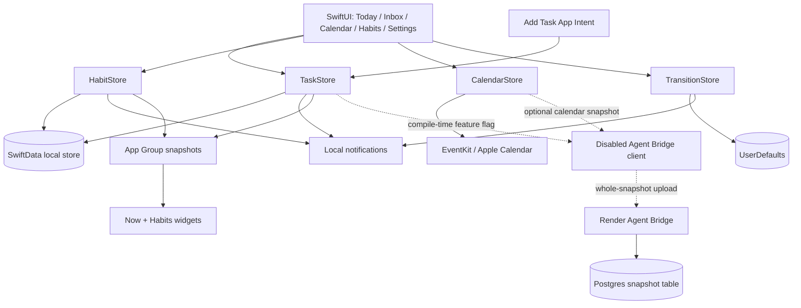
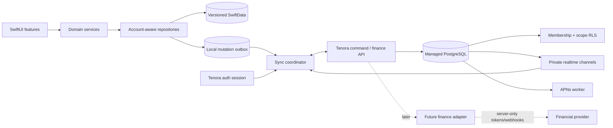

# Tenora Family Transition — Architecture Audit and Recommendation

**Audit date:** October 23, 2026
**Scope:** Repository after product Step 02 and the first Step 03 household identity migration.

## Executive recommendation

Preserve Tenora as a local-first app and introduce a separate authenticated collaboration layer backed by managed PostgreSQL. The recommended first platform is Supabase for Postgres, Auth, row-level security, and realtime delivery, accessed through application-owned repositories and a small server-side command boundary. Existing SwiftData remains the local working set and offline cache.

Do not turn on cloud collaboration by adding `householdID` directly to today's SwiftData models. First freeze the current schema with `VersionedSchema`, make export/restore comprehensive, centralize scattered preference persistence, and prove upgrades from a real prior store. Then introduce identity and sync metadata in additive migrations.

All existing records migrate to a private personal workspace. Household records are created or shared deliberately. Calendar events remain on-device; only coarse availability should be shareable by default. The current Agent Bridge is useful evidence but must not become the collaboration backend.

## Current system architecture

### Application startup and dependency ownership

- `TenoraApp` injects one `AppRuntime` into the SwiftUI environment.
- `AppRuntime` is a `@MainActor` singleton that resolves the active local profile, creates its settings/outbox/repositories, then creates one `ModelContainer`, `TaskStore`, `HabitStore`, `CalendarStore`, and `TransitionStore`.
- Presentation stores depend on repository protocols. `HabitStore` no longer imports or queries SwiftData, and the settings screens observe `AppSettingsStore` rather than owning raw defaults keys.
- SwiftData initialization now uses the explicit V1 schema. An ordinary persistent-store open failure shows a non-destructive recovery screen backed by a temporary in-memory container; the original store is not deleted.
- Store `didChange` closures fan changes out to widgets, notifications, calendar-trigger resolution, and—only when compiled with `TENORA_AGENT_BRIDGE_ENABLED`—snapshot synchronization.
- `RootTabView` owns a four-tab `TabView`, deep-link routing, task/habit sheets, scene lifecycle refresh, and a repeating 60-second foreground refresh loop.
- Settings are reachable from all task-oriented tabs and the Habits tab; Agent Bridge settings are absent in the default build.

### Navigation

Implemented routes include:

- tabs: Today, Inbox, Calendar, Habits;
- task capture and task detail sheets;
- habit detail and editor sheets;
- morning/evening review, recovery, “I'm stuck,” Hold My Place, Just Start, and return-trigger flows;
- settings detail pages for weekly schedule, calendar, reminders, recovery, data/privacy, and about;
- URL routes for `tenora://add`, `tenora://today`, `tenora://task/<uuid>`, `tenora://habits`, and `tenora://habit/<uuid>`.

Settings now contains a concise Account destination. A privacy gate replaces personal
content during an incomplete or cross-profile account transition. There is still no
household, membership, invite, people, shared-list, or household activity navigation.

### Phase 3 identity boundary

- `AccountStore` owns optional adult session state independently from the disabled Agent Bridge.
- `AdultAuthenticationProvider` and `ProfileAssociationRepository` keep domain and presentation code independent of Supabase types.
- The production adapter uses Supabase Swift 2.55.4, native Sign in with Apple, and the SDK's supported Keychain session storage.
- A private `auth.users` trigger maps each Supabase Auth UUID to a stable Tenora UUID; the provider UUID is never used as the local profile or future record owner ID.
- Local account/profile associations are explicit, durable, and recoverable. They do not copy or upload local records.
- Cross-profile restores lock the productivity UI and clear destination widget snapshots before activating another local namespace.
- The outbox remains profile-scoped and has no network consumer.

The implementation and operational lifecycle are detailed in
[ACCOUNT_LIFECYCLE.md](ACCOUNT_LIFECYCLE.md).

## Current persistence inventory

### SwiftData entities

| Entity | Persisted information | Notes |
|---|---|---|
| `StoredTask` | Stable UUID, title/notes, created/due/scheduled/preferred dates, duration, status, priority, resurfacing/snooze counters, completion, source, tags, next step, held state/reason, last worked, Just Start timing, encoded return trigger, keep-in-front expiry | No owner, account, household, scope, revision, tombstone, or sync state. `tags: [String]` emits a non-failing Core Data materialization warning in tests. |
| `StoredHabit` | UUID, name/details, icon/color, created/archive state, legacy difficulty, encoded schedule, reminder minute | Personal-only; schedule is opaque encoded `Data`. |
| `StoredHabitCompletion` | UUID, habit UUID, completion date, legacy XP, creation date | No enforced SwiftData relationship or cascade; app deletes dependents manually. |
| `StoredPlayerProgress` | One `local-player` record with legacy XP/level and practical completion/momentum counts | Current engine returns level 1 and zero XP but writes progress. Preserve for prior installations. |
| `StoredGameUnlock` | Unlock ID, kind, date | Legacy persistence retained; no current practical habit UI use. |

The container is created through `TenoraModelContainerFactory` from `TenoraSchemaV1`
and `TenoraMigrationPlan`. An automated test opens an unversioned store through the V1
container, but immutable stores created by the last distributed binary are not yet checked
in. The task-tags representation is deliberately unchanged in V1 because replacing its
inferred transformer changed the schema signature during compatibility testing.

The `offline` profile deliberately retains the original store location. Any future
authenticated profile receives a separate store under `Application Support/Tenora Profiles`.
Switching profiles currently requires rebuilding `AppRuntime` through a normal app launch;
live account switching belongs to Phase 3.

### Other local persistence

| Location | Information |
|---|---|
| Standard `UserDefaults` | `UserDefaultsSettingsRepository` stores Tenora preferences under `profile.<profile>.settings.v1.*`. The offline profile copies and mirrors legacy keys for compatibility. Agent Bridge preferences remain isolated in its disabled subsystem. |
| App Group `UserDefaults` | Active-profile marker plus profile-keyed task/calendar widget snapshot, habit widget snapshot, and queued interactive habit-completion IDs |
| Application Support JSON | `FileMutationOutbox` stores durable mutation envelopes in one atomic file per local profile. Nothing reads these files for upload yet. |
| Keychain | Supabase account session through the supported SDK default; disabled Agent Bridge tokens remain in their separate Keychain entry |
| EventKit | Calendar events are read live and are not persisted in SwiftData |

The profile namespace now prevents ordinary cross-profile reads, but deletion and export
must still coordinate SwiftData, settings, outbox, App Group state, and Keychain.

### Backup, restore, and deletion

The app exports a versioned, checksummed local backup containing all five SwiftData
entities, transitions, focus and recovery state, working schedule, and Tenora-owned
attention/calendar/reminder preferences. Calendar events and OAuth tokens are explicitly
excluded. The decoder also accepts the prior incomplete export format.

Restore verifies the checksum and record relationships, stages all records in an isolated
in-memory store, writes a pre-restore recovery backup in Application Support, then replaces
live SwiftData records inside a transaction. The UI requires explicit confirmation and
reloads stores, transition plans, and focus afterward.

Remaining gaps:

- The first release uses a clean-install device smoke test; the historical-data restore drill was explicitly waived because current development data may be discarded.
- Cloud account export/deletion is separate, and the disabled Agent Bridge can retain a server snapshot unless its dedicated delete succeeds.
- App Group widget snapshots and transient notification queues are regenerated rather than included in backup.

## Feature status

### Implemented

#### Task and attention system

- Quick capture, edit, delete, complete, archive states, deadlines, scheduling, preferred time, duration, priority, notes, and tags.
- Inbox swipe actions and long-press actions.
- NOW recommendation scoring and explanations.
- Per-weekday and overnight working schedules with DST-aware tests.
- Calendar-aware fit, buffers, minimum usable gap, and selected calendar filtering.
- Capacity modes: balanced, easy win, interesting, important, mindless, quick, and momentum.
- Adaptive resurfacing/postponement.
- “Keep this in front today.”
- Smallest next step.
- Hold My Place with reason and return time.
- Just Start for short sessions, with notification actions.
- Lost Track Recovery and resume after absence.
- “I'm stuck” assistance with multiple blocker paths.
- Return triggers after another task, an event, or a free window.
- Soon/Later day horizon, event transitions, morning review, and evening reset.

#### Habits

- Habit create/edit/archive/delete.
- Every day, selected weekdays, times-per-week, and custom interval schedules.
- Optional local reminder time.
- Today and prior-day check-ins with undo/correction.
- Weekly and recent completion summaries and history UI.
- Interactive habit widget completion queue.
- Practical, non-gamified presentation using 36 bundled habit icon image sets.

#### Platform integration

- EventKit full read access and on-device availability calculations.
- Local task, Just Start, transition, and habit notifications with actions.
- Small and medium NOW widget and habit widget; task widget is marked privacy-sensitive.
- App Intent / App Shortcut for adding a task.
- Deep links for tasks, habits, Today, and capture.
- App Group sharing between app and widgets.

#### Quality and distribution groundwork

- App and widget privacy manifests declare UserDefaults access and no tracking.
- App icon, logo, theme colors, and habit assets are bundled.
- 117 unit tests and 10 UI tests are defined and passing.
- Agent Bridge has a lockfile, six Node tests, a TypeScript build, Dockerfile, Render blueprint, and GitHub Actions workflow.

### Partially implemented

| Feature | What exists | Missing or unsafe for production |
|---|---|---|
| Optional adult account | Normal-app state machine, native Apple client, Supabase Keychain session, stable Tenora UUID mapping, explicit local-profile association, and privacy gate | External provider/migration not verified; no cloud deletion/export, email link, or multi-device personal sync |
| Agent Bridge account onboarding | Auth0/OIDC PKCE and separate Keychain token flow | Compiled out by default and deliberately isolated from the Tenora account identity |
| Cloud sharing | Opt-in task snapshot with separate note/calendar toggles | One-way full replacement; no client download, edits, conflicts, tombstones, retry queue, or household scope |
| Agent access | Read-only MCP tools scoped to authenticated `sub` | Feature disabled; no production rate limiting/monitoring demonstrated; no household-aware authorization; no write tools |
| Backend authorization | JWT issuer/audience/scope validation and forced Postgres RLS by `app.user_id` | Only one row per user; no household memberships/roles/invites; Postgres integration is not exercised by the current test suite |
| Data portability | Versioned/checksummed backup, validated restore with recovery copy, legacy export import, and destructive local reset | Physical-device drill and cloud export/deletion orchestration remain |
| Gamification | Legacy persistence entities and fields | Current UI/engine intentionally suppress XP/levels; no migration contract documents prior values |
| Test automation | Local iOS tests are green; backend CI exists; legacy-store and backup/restore regressions are covered | No iOS GitHub Actions workflow; no released-binary fixture matrix, RLS integration, or sync conflict tests |
| Calendar connection | Reads local calendars, filter/buffer settings | No writes, shared household calendar, provider-to-server integration, or privacy-safe availability sync |

### Missing

- Verified production provider configuration and complete cloud account deletion/export lifecycle.
- Households, memberships, roles, invitations, revocation, and ownership transfer.
- Record scope/visibility, creator, assignee, participants, comments, and activity history.
- Collaborative task/list/routine mutation APIs.
- Offline outbox/inbox sync, server revisions, tombstones, idempotency, and conflict handling.
- Push notifications for remote household changes or assignments.
- Server-side audit logs and household security tests.
- Multi-device restore and account-aware widget safety.
- Shared calendar/availability controls.
- Financial models, integrations, consent, token storage, webhook handling, and compliance controls.
- Child/dependent identity model.

## Current backend audit

The `AgentBridge` service is an Express/TypeScript read-only MCP server plus an opt-in snapshot upload endpoint.

### What it does well

- Validates OAuth JWT issuer, audience, signature, and scopes.
- Separates phone upload scope (`tasks:sync`) from MCP read scope (`tasks:read`).
- Uses a non-superuser Postgres role and forces RLS.
- Keys each snapshot to the authenticated token's subject rather than accepting a user ID from request JSON.
- Validates payloads with strict Zod schemas and limits request size and record counts.
- Provides deletion and excludes task notes/calendar details until separately enabled.
- Exposes only read-only MCP tools.

### Why it is not the household backend

- `tenora_snapshots` has one JSON payload row per user, not normalized records.
- Upload replaces the entire snapshot; the phone is the only source of truth.
- There is no API to download or mutate records from another device.
- There are no household, membership, role, invitation, assignment, or resource-scope tables.
- There are no server revisions, mutation IDs, tombstones, conflict semantics, or durable outbox.
- Calendar titles can be included wholesale, which is not an appropriate default for household availability.
- Current backend tests use in-memory repositories; they do not prove the Postgres role, transaction-local `app.user_id`, or RLS policies against a real database.
- Render's free deployment and the README's own production TODOs (rate limiting, backups, monitoring, retention) identify it as a prototype.

## Target architecture

### Client layers

1. **Presentation:** Existing SwiftUI screens continue to call stores/view models.
2. **Domain:** Existing priority, availability, resurfacing, recovery, and habit engines remain deterministic and provider-independent.
3. **Repository:** Task, habit, completion, retained progress, transition, settings, and profile protocols are implemented locally. Household repositories arrive only with the household model. Phase 4 must make local data and outbox writes transactionally consistent before transmission.
4. **Local database:** Versioned SwiftData contains personal and cached shared records plus sync metadata. Secrets stay in Keychain.
5. **Sync coordinator:** Uploads idempotent mutations, downloads changes after a cursor, updates local state, resolves expected conflicts, and reports actionable failures without blocking personal use.
6. **Auth session:** Owns account state independently from Agent Bridge and maps the provider identity to a stable Tenora user UUID.

### Server layers

1. **Auth:** Tenora account sign-in (recommended: Sign in with Apple plus email magic link; password login only if product support is prepared for it).
2. **PostgreSQL:** Normalized records, constraints, RLS, revisions, and audit events.
3. **Command/API boundary:** Required for invitations, membership changes, ownership transfer, finance, push fanout, and operations that must be transactional or must not expose service credentials.
4. **Realtime:** Notification that authorized records changed, not the only delivery path. Cursor sync remains authoritative after reconnect.
5. **Workers/functions:** APNs, invitation email, retention, and future financial webhooks.

### Recommended data scopes

| Data | Default scope | Household representation |
|---|---|---|
| Personal task title/notes | Personal | Shared only by explicit move/copy |
| Shared chore/task | Household | Full shared record with creator/assignee/history |
| Keep-in-front, focus, capacity, recovery | Personal | Never inferred as household state; per-member task presentation can be separate |
| Habit and check-in history | Personal | Household routine should be a distinct collaborative type or an explicit shared habit |
| Working hours | Personal | Optional coarse availability windows only |
| Calendar event title/notes/attendees | Personal/device-only | Not uploaded by default |
| Busy/free interval | Personal | Opt-in derived interval, no source title, short retention |
| Reminder settings | Personal/device-specific | Household notification policy can be separate |
| Legacy XP/unlocks | Personal/archival | Preserved, not shared |
| Household membership and roles | Household | Server-authoritative |
| Financial connection/token | Server-restricted | Never exposed to general household client tables |

### Relational core

Implemented identity and Step 03 foundation:

- `tenora_users(id, created_at)`
- `user_identities(id, user_id, auth_user_id, provider, provider_subject, created_at)`
- `account_profiles(user_id, display_name, created_at, updated_at)`
- `households(id, name, created_by, created_at, updated_at)`
- `household_memberships(id, household_id, user_id, role, status, invited_by, joined_at, ended_at, created_at)`
- `household_invitations(id, household_id, created_by, recipient_email, token_hash, role, status, expires_at, accepted_by, accepted_at, created_at)`
- `household_audit_events(id, household_id, actor_user_id, event_type, subject_user_id, invitation_id, occurred_at)`

The database enforces one active household per adult for this release. Household creation
atomically creates an owner membership. Clients receive no direct mutation privilege for
memberships, invitations, or audit events; invitation and membership lifecycle operations
will use controlled command functions.

Planned shared-record core after the membership and permission gates:

- `tasks(id, scope, owner_user_id, household_id, created_by, assigned_to, fields…, version, created_at, updated_at, deleted_at)`
- `task_participants(task_id, user_id, permission)` only when selected-member sharing is introduced
- `task_events(id, task_id, actor_user_id, kind, payload, client_mutation_id, occurred_at)`
- `habits` and `habit_completions` with the same scope rules; keep personal by default
- `member_task_preferences(user_id, task_id, keep_in_front_until, local_attention_fields…)`
- `availability_blocks(id, user_id, household_id, starts_at, ends_at, expires_at)` with no event content
- `sync_changes(sequence, household_id, user_id, entity_type, entity_id, operation, version, changed_at)` or an equivalent change-feed abstraction
- `audit_events(id, actor_user_id, household_id, action, target_type, target_id, security_context, created_at)`

Finance tables should live in a separate restricted schema with separate roles and retention policies.

### Authorization model

Minimum adult roles:

- `owner`: manages the household and ownership transfer.
- `admin`: manages members/invites and household configuration.
- `adult`: collaborates on household records.

All roles can access household-scoped records while active unless the product later introduces selected-member records. No household role can access a different adult's personal records.

RLS predicates must enforce both authentication and authorization:

- personal row: `owner_user_id == current_tenora_user()`;
- household row: active membership exists for `household_id`;
- insert/update: new scope, owner, and household values also satisfy the policy;
- membership administration: role-specific server command, not arbitrary client table update;
- revoked member: no active membership means immediate policy denial;
- service operations: isolated role/schema, explicit user/household validation, auditable use.

The client publishable key is not an authorization mechanism. A secret/service key must never be embedded in Tenora.

## Synchronization design

### Local metadata

Each syncable record needs:

- stable UUID preserved from current data;
- `scope`, `ownerUserID`, optional `householdID`;
- `serverVersion`, `updatedAt`, optional `deletedAt`;
- local dirty/conflict state;
- last successful server acknowledgement.

The outbox stores `clientMutationID`, entity ID/type, intended operation, base server version, payload, attempt count, and timestamps. It must survive app termination.

### Protocol

1. The repository commits the user-visible local change and outbox mutation.
2. The sync coordinator authenticates and submits a batch with idempotency keys.
3. The server checks scope/membership and base version in a transaction.
4. The server applies or rejects each mutation and emits a monotonic change revision.
5. The client downloads changes after its cursor, including tombstones.
6. Local records are reconciled; accepted mutations leave the outbox only after acknowledgement.
7. Realtime/APNs wakes sync but never replaces cursor catch-up.

### Conflict policy

- Completion, comment, and audit activity are immutable events and deduplicate by mutation UUID.
- Assignment, title, due date, and schedule use optimistic concurrency.
- Non-overlapping field changes may merge if the server owns a field-level merge contract.
- Simultaneous incompatible edits create a conflict record or present a choice; they are not silently lost.
- Deletion wins only after retention/tombstone rules; an offline edit to a deleted record becomes a visible recovery choice.

## Data-preserving migration strategy

### Stage 0 — Establish a recoverable baseline

1. Tag the last local-only release and record its exact schema.
2. Add a comprehensive, versioned export including all SwiftData entities, all Tenora-owned preference keys, transition plans, focus state, and legacy progress/unlocks.
3. Add restore/import into an isolated temporary store, with validation before replacement.
4. Create upgrade fixture databases from the released app, including empty, typical, large, legacy-game, overnight-schedule, and malformed/edge values.
5. Introduce `TenoraSchemaV1` and a migration plan that exactly describes today's models.
6. Resolve the `[String]` tags warning through an explicit compatible representation/migration.

### Stage 1 — Add identity without moving data

1. Add stable local installation and optional Tenora user UUIDs.
2. Implement account session independently from Agent Bridge.
3. Keep personal/offline mode available.
4. Verify sign-in/out does not switch, delete, or expose local data implicitly.
5. Define account-linking and “this device already has data” UX before upload.

### Stage 2 — Add sync metadata additively

1. Add scope/owner/household/revision/tombstone fields in an explicit next schema version.
2. Backfill every current record as `personal`, with the signed-in Tenora user as owner only after consent; otherwise retain a local-only owner marker.
3. Preserve record UUIDs and all timestamps/counters/encoded fields.
4. Move or mirror scattered preferences into an account-aware, versioned settings repository while retaining compatibility reads during rollout.
5. Do not delete old keys until at least one successful migration and rollback window has passed.

### Stage 3 — Idempotent personal import

1. Create a pre-import backup and counts/checksums by entity type.
2. Upload batches with a migration ID, record UUID, source installation ID, schema version, and idempotency key.
3. Keep SwiftData authoritative until the server acknowledges and the client downloads the same records.
4. Compare counts, IDs, essential field hashes, and representative content.
5. Mark migration complete only after reconciliation; retries reuse the same migration ID.
6. Never upload EventKit events, Keychain tokens, or private notes under a broad default consent.

### Stage 4 — Household opt-in

1. Create/join household separately from personal migration.
2. Existing data remains private.
3. New shared records choose the household explicitly; moving an existing record requires a confirmation that names what will become visible.
4. Preserve original UUID and history when moving scope, or create an explicit linked copy if reversal semantics require it.

### Rollback

- Feature flags can disable cloud reads/writes independently.
- Local data remains available even when cloud sync is disabled.
- A migration journal records before/after schema versions, counts, and server import ID.
- No destructive local cleanup occurs in the same release that introduces cloud migration.
- Legacy progress/unlock records remain untouched even though the current UI does not display them.

## Technical risks

| Risk | Severity | Evidence | Mitigation |
|---|---|---|---|
| SwiftData evolution loses or rejects released stores | Critical after first public release | V1 and a generated legacy-store test exist; pre-release historical fixtures were waived because development data may be discarded | Capture immutable release fixtures before V2 and require upgrade/retry tests for every post-release schema change |
| Privacy leak across adults/households | Critical | Current records have no scope/owner fields | Explicit scope, RLS, command authorization, adversarial cross-tenant tests |
| Existing records accidentally become shared | Critical | No current notion of personal vs shared | Backfill personal only; explicit share confirmation; migration tests |
| Whole-snapshot overwrite/data loss | Critical | Agent Bridge replaces one JSON snapshot | New incremental protocol with versions, mutations, tombstones, cursors |
| Fragmented local state is omitted from migration | High | SwiftData + multiple defaults suites + Keychain + EventKit | Formal data inventory, settings repository, export schema, per-key tests |
| `tags` persistence compatibility | High | Core Data warning during passing tests; changing the transformer altered the V1 schema signature | Preserve V1 representation; migrate explicitly in V2 only after released-store fixture tests |
| Habit completion referential integrity | High | UUID reference, manual cascade | Server FKs; local migration and orphan validation |
| Stale session retains sensitive access | High | Future household/finance requirement | Short-lived sessions for sensitive actions, server membership checks, revoke/sign-out flow |
| Widget exposes wrong account/household data | High | Shared App Group snapshot has no account namespace | Namespace snapshots by local profile; clear on sign-out/scope change; redacted lock-screen defaults |
| Calendar over-sharing | High | Bridge can upload full event titles when enabled | Derived availability-only model; explicit separate content consent |
| Finance expands breach/compliance scope | Critical | No current controls | Separate schema/service/roles, provider token vault, audit/retention/legal review; defer |
| Current tests provide false confidence | Medium | Local suite is green, but there are no released-store matrix, RLS, or sync integration tests | Add immutable upgrade fixtures, database policy tests, and multi-client suites |
| Privacy manifest becomes inaccurate after cloud launch | High | It currently declares no collected data | Reassess manifest, App Store privacy labels, policy, export/deletion before enabling cloud |
| Background sync behavior is unreliable | Medium | Current work refreshes only while foregrounded | BackgroundTasks/push design with resilient foreground catch-up |
| Auth/vendor migration complexity | Medium | Prototype treats Auth0 `sub` as canonical | Application user UUID and provider identity mapping |

## Dependency and asset audit

### iOS

- 68 Swift source files / approximately 7,905 lines across app, widget, and shared code.
- No third-party Swift Package Manager dependencies in the Xcode project.
- Apple frameworks used: SwiftUI, SwiftData, EventKit, UserNotifications, WidgetKit, AppIntents, AuthenticationServices, CryptoKit, Security, UIKit, and UniformTypeIdentifiers.
- App Group entitlement: `group.com.tenora.app` on app and widget.
- iPhone-only target (`TARGETED_DEVICE_FAMILY = 1`), minimum iOS 17.
- Asset catalog includes app icon, Tenora logo, theme colors, and 36 practical habit icons.
- Privacy manifests exist for app and widget.

### Agent Bridge

- Runtime dependencies: MCP SDK, Express, `jose`, `pg`, and Zod.
- Development dependencies: TypeScript, `tsx`, and type definitions.
- Versions are represented with compatible-range specifiers in `package.json`, but the committed `package-lock.json` provides the reproducible CI resolution.
- Docker and Render configuration exist. Backend-only GitHub Actions runs install, tests, build, and Docker build.

## Verification findings

See [PROGRESS.md](PROGRESS.md) for commands and exact results. In summary:

- Unsigned generic iPhone build: passed, including Tenora and TenoraWidgets.
- iOS unit tests: 105/105 passed after Phase 2 (the Phase 1 baseline was 96/96).
- iOS UI tests: 9/9 passed.
- Agent Bridge TypeScript build: passed.
- Agent Bridge tests: 6/6 passed.
- A generated unversioned SwiftData upgrade and backup/restore suite now pass. No released-binary fixture matrix, database integration, RLS adversarial, multi-device sync, or finance security tests exist.

## Required implementation sequence

1. Data safety: complete for the clean-start initial release; release fixtures and the tags migration gate become mandatory before V2.
2. Persistence boundaries: complete; repositories, profile namespaces, compatibility settings, widget isolation, and a dormant durable outbox are in place.
3. Cloud foundation: stable Tenora identity, Postgres schema, RLS, audit, API, CI security tests.
4. Personal sync pilot: idempotent outbox/cursor protocol and reversible private import.
5. Household identity: create/join/invite/revoke/transfer ownership.
6. Shared tasks/routines: explicit scope, assignment, activity, remote notifications, conflict UX.
7. Privacy-safe scheduling: derived availability and household calendar views.
8. Hardening and staged beta: migration metrics, backup/restore drills, accessibility, threat model, support/admin tools.
9. Finance discovery only after the household platform passes security and reliability gates.
